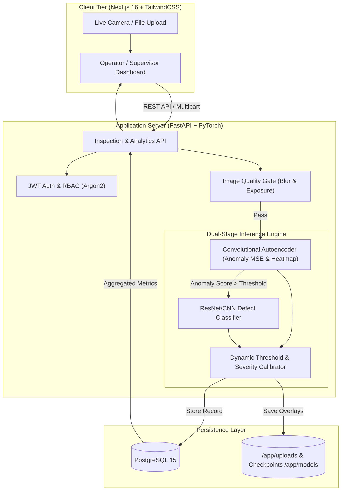

# 🔍 VisionInspect AI

<p align="center">
  <strong>Autonomous Industrial Defect Detection & Quality Assurance Platform</strong>
</p>

<p align="center">
  
  
  
  
  
  
  
</p>

---

## 📋 Overview

**VisionInspect AI** is an end-to-end computer vision platform engineered for real-time manufacturing quality control and automated optical inspection (AOI). Combining unsupervised deep learning (Convolutional Autoencoders) with supervised transfer learning (ResNet-based classifiers), VisionInspect AI detects surface anomalies, classifies defect typologies, generates pixel-level reconstruction heatmaps, and tracks quality metrics across manufacturing lines.

Trained and calibrated on the **MVTec Anomaly Detection (MVTec AD)** industrial benchmark, VisionInspect AI supports a comprehensive matrix of rigid parts, flexible materials, and textured surfaces.

---

## ✨ Key Features

- **🧠 Dual-Stage ML Pipeline**:
  - **Stage 1 (Unsupervised Anomaly Detection)**: Convolutional Autoencoder reconstructs defect-free representations and computes localized Mean Squared Error (MSE) / Structural Dissimilarity to isolate anomalies without requiring prior defect masks.
  - **Stage 2 (Supervised Defect Classification)**: Deep CNN / Fine-tuned ResNet model categorizes detected anomalies into specific manufacturing failure classes (e.g., *broken*, *contamination*, *scratches*, *threads*, *cracks*).
- **🗺️ Anomaly Localization & Heatmaps**: Automatically outputs color-coded anomaly heatmaps and bounding-box overlays identifying the exact coordinates and severity of imperfections.
- **📷 Pre-Inference Quality Gate**: Automatic pre-check for image clarity (Laplacian variance blur detection) and photometric exposure before feeding images into the neural network.
- **🏭 Multi-Category Industrial Matrix**: Dynamic category switching supporting 10+ standard manufacturing product lines (Bottle, Cable, Capsule, Carpet, Grid, Hazelnut, Leather, Metal Nut, Pill, Screw, Tile, Toothbrush).
- **📊 Real-time SPC & Analytics Dashboard**: Built-in Statistical Process Control metrics, interactive charts (yield rate, defect distribution by type and category, pass/fail ratios, timeline trends) powered by Recharts.
- **🔐 Enterprise RBAC & Security**: JWT-based token authentication with Argon2 password hashing. Fine-grained roles:
  - **Inspector**: Upload inspection imagery, run inference, view personal inspection history.
  - **Supervisor / Admin**: Global audit logs, system-wide analytics, manual defect override capabilities, and inspection parameter threshold configurations.
- **📹 Dual-Input Modes**: Direct drag-and-drop file upload (single / batch) alongside live webcam stream inspection for line-side testing.
- **🐳 Production-Ready Containerization**: Zero-configuration orchestration with Docker Compose, health-checked microservices, persistent volume mapping, and isolated PostgreSQL database.

---

## 🏗️ System Architecture



---

## 🗂️ Project Structure

```text
VisionInspect-AI/
├── backend/                        # FastAPI Application & ML Service
│   ├── app/
│   │   ├── routers/
│   │   │   ├── auth_router.py      # Authentication & User Management
│   │   │   └── inspection_router.py# Upload, Inference, Overrides, Analytics
│   │   ├── auth.py                 # JWT token generation & password hashing
│   │   ├── database.py             # SQLAlchemy engine & session setup
│   │   ├── image_quality.py        # Blur & lighting validation
│   │   ├── main.py                 # FastAPI application factory & lifecycle
│   │   ├── ml_inference.py         # PyTorch inference, heatmaps, model loading
│   │   ├── models.py               # SQLAlchemy ORM models (User, Inspection)
│   │   ├── schemas.py              # Pydantic data contracts
│   │   ├── severity.py             # Defect scoring & severity computation
│   │   └── thresholds.py           # Category-specific anomaly limits
│   ├── Dockerfile                  # Multi-stage Backend container
│   └── requirements.txt            # Python dependencies
├── ml/                             # Machine Learning Training & Evaluation
│   ├── models/                     # Saved model weights (*.pth)
│   ├── model_defs.py               # Autoencoder & Classifier PyTorch architectures
│   ├── train_autoencoder.py        # Unsupervised training pipeline
│   ├── train_classifier.py         # Supervised defect classification trainer
│   ├── train_category.py           # Unified single-category training & calibration
│   ├── compare_thresholds.py       # Threshold calibration & ROC curves
│   └── visualize_defect.py         # Standalone heatmap visualizer script
├── web-app/                        # Next.js 16 Web Application
│   ├── src/
│   │   ├── app/
│   │   │   ├── inspect/            # Live inspection & webcam interface
│   │   │   ├── history/            # Historical inspections & audit logs
│   │   │   ├── settings/           # System configuration & thresholds
│   │   │   ├── login/              # Authentication portal
│   │   │   └── page.tsx            # Main Analytics & SPC Dashboard
│   │   └── components/             # Reusable UI widgets (Sidebar, TopNav, etc.)
│   ├── Dockerfile                  # Multi-stage Next.js container
│   └── package.json                # Frontend packages & scripts
├── docker-compose.yml              # Complete multi-service orchestration
├── train_all.py                    # Automated multi-category batch trainer
└── README.md                       # Project documentation
```

---

## 🛠️ Technology Stack

| Layer | Technologies |
| :--- | :--- |
| **Frontend** | [Next.js 16](https://nextjs.org/) (App Router), [React 19](https://react.dev/), [TypeScript](https://www.typescriptlang.org/), [Tailwind CSS v4](https://tailwindcss.com/), [Recharts](https://recharts.org/), [Lucide React](https://lucide.dev/) |
| **Backend API** | [FastAPI](https://fastapi.tiangolo.com/), [Uvicorn](https://www.uvicorn.org/), [Pydantic v2](https://docs.pydantic.dev/), [SQLAlchemy 2.0](https://www.sqlalchemy.org/) |
| **Machine Learning**| [PyTorch](https://pytorch.org/), [Torchvision](https://pytorch.org/vision/), [OpenCV](https://opencv.org/), [NumPy](https://numpy.org/), [Pillow](https://python-pillow.org/) |
| **Security** | JSON Web Tokens (JWT), Argon2 password hashing (`pwdlib`), CORS policies, Role-Based Access Control |
| **Database** | [PostgreSQL 15](https://www.postgresql.org/) (or SQLite for light development) |
| **DevOps & Deploy** | [Docker](https://www.docker.com/), [Docker Compose](https://docs.docker.com/compose/) |

---

## 🚀 Quickstart with Docker Compose

The fastest way to launch the entire platform (PostgreSQL, Backend API, and Next.js Frontend):

### 1. Clone the Repository

```bash
git clone https://github.com/EmmadiAmulya/VisionInspect-AI.git
cd VisionInspect-AI
```

### 2. Environment Configuration

Create a `.env` file in the project root:

```env
POSTGRES_PASSWORD=vision_secure_password
SECRET_KEY=your-production-secret-key-32-chars-long
ADMIN_USERNAME=admin
ADMIN_PASSWORD=adminpassword123
ADMIN_EMAIL=admin@visioninspect.local
```

### 3. Build & Run Containers

```bash
docker compose up --build -d
```

The services will initialize:
- **Web Application**: [http://localhost:3000](http://localhost:3000)
- **FastAPI Backend & Interactive API Docs**: [http://localhost:8000/docs](http://localhost:8000/docs)
- **Database**: PostgreSQL exposed internally on port `5432`

---

## 💻 Manual Local Development Setup

If you prefer to run services natively without Docker:

### Prerequisites

- Python 3.10 or 3.11
- Node.js 18+ and `npm`
- PostgreSQL instance running (or change `DATABASE_URL` to SQLite `sqlite:///./visioninspect.db`)

### 1. Backend Setup

```bash
# Navigate to backend directory
cd backend

# Create and activate virtual environment
python -m venv venv
# On Windows:
venv\Scripts\activate
# On Linux/macOS:
source venv/bin/activate

# Install requirements
pip install -r requirements.txt

# Create .env file
cp .env.example .env

# Run FastAPI server
uvicorn app.main:app --host 0.0.0.0 --port 8000 --reload
```

Interactive API documentation will be available at [http://127.0.0.1:8000/docs](http://127.0.0.1:8000/docs).

### 2. Frontend Setup

```bash
# In a new terminal, navigate to web-app
cd web-app

# Install dependencies
npm install

# Start development server
npm run dev
```

Visit [http://localhost:3000](http://localhost:3000) in your browser.

---

## 🧠 Machine Learning Training Pipeline

VisionInspect AI uses the **MVTec Anomaly Detection** dataset format.

### 1. Training a Single Category

To train the Autoencoder and Classifier on an individual category (e.g., `bottle`) and calibrate optimal decision boundaries:

```bash
python ml/train_category.py --category bottle --calibrate
```

This will:
1. Train a Convolutional Autoencoder on normal defect-free samples.
2. Train a multi-class Classifier on labeled defect classes.
3. Automatically determine anomaly reconstruction error cutoffs and save weights to `ml/models/`.

### 2. Training All Supported Categories in Batch

Run the master batch automation script:

```bash
python train_all.py
```

Supported categories include:
- `bottle`
- `cable`
- `capsule`
- `carpet`
- `grid`
- `hazelnut`
- `leather`
- `metal_nut`
- `pill`
- `screw`
- `tile`
- `toothbrush`

---

## 📡 REST API Reference

| Method | Endpoint | Description | Access |
| :--- | :--- | :--- | :--- |
| `POST` | `/auth/register` | Register new user account | Public |
| `POST` | `/auth/login` | Authenticate and obtain JWT Bearer Token | Public |
| `GET` | `/auth/me` | Fetch current authenticated user profile | All Roles |
| `POST` | `/upload` | Submit inspection image (`multipart/form-data`) | Inspector, Supervisor |
| `POST` | `/visualize` | Generate anomaly heatmap and bounding overlays | Inspector, Supervisor |
| `GET` | `/categories` | List active supported product categories and models | All Roles |
| `GET` | `/history` | Paginated inspection audit history with filters | Role Filtered |
| `GET` | `/analytics` | Yield rates, defect distributions, pass/fail totals | All Roles |
| `GET` | `/trends` | Chronological defect rate trends and timelines | All Roles |
| `GET` | `/quality-report` | Comprehensive quality summary and defect metrics | Supervisor |
| `PUT` | `/{id}/override` | Manually override an AI defect decision | Supervisor |
| `GET` | `/config/settings` | Read operational anomaly thresholds | Supervisor |
| `POST` | `/config/settings` | Update operational anomaly thresholds | Supervisor |

---

## 📸 User Interface Preview

- **Inspection Terminal**: Upload single/batch product images or connect line webcams. View real-time Pass/Fail verdict, confidence score, defect class, reconstruction error, and localized heatmaps.
- **Executive SPC Dashboard**: Monitor line yield percentages, defect breakdown by severity (Minor, Moderate, Critical), and time-series defect volumes.
- **History & Traceability**: Searchable audit log allowing supervisor review and human-in-the-loop decision overrides.

---

## 🤝 Contributing

Contributions are welcomed! Follow these steps to contribute:

1. **Fork** the repository
2. **Create** your feature branch (`git checkout -b feature/AmazingFeature`)
3. **Commit** your changes (`git commit -m 'Add some AmazingFeature'`)
4. **Push** to the branch (`git push origin feature/AmazingFeature`)
5. **Open** a Pull Request

---

## 📄 License

Distributed under the **MIT License**. See `LICENSE` for more information.

---

## 📬 Contact & Support

Developed by **Amulya Emmadi**  
- GitHub: [@EmmadiAmulya](https://github.com/EmmadiAmulya)  
- Project Repository: [VisionInspect-AI](https://github.com/EmmadiAmulya/VisionInspect-AI)
